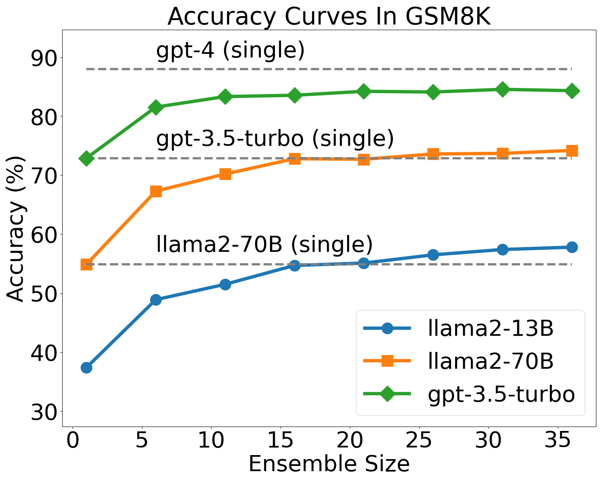

# More Agents Is All You Need

[](https://openreview.net/forum?id=bgzUSZ8aeg)
[](https://arxiv.org/abs/2402.05120)
[](https://huggingface.co/papers/2402.05120)

Official implementation of **[More Agents Is All You Need](https://openreview.net/forum?id=bgzUSZ8aeg)** (TMLR 2024), demonstrating **Test-Time Scaling** and **Inference-Time Scaling** for large language models via **Multi-Agent Scaling**. Using a simple **Sampling-and-Voting / Majority Voting** method, LLM performance scales consistently with the number of instantiated agents across reasoning and generation benchmarks, orthogonal to existing prompting and collaboration techniques.

<p align="center">
  
</p>

## Preliminary Setup
Our framework supports a range of Large Language Models, including the GPT series hosted on Azure and various open-source LLMs. To integrate these models into our experimental setup, users must define the necessary API keys and model deployment IP addresses as environment variables:

```bash
# For GPT series LLMs hosted on Azure
export OPENAI_KEY="YOUR_OPENAI_KEY"
export OPENAI_IP="YOUR_OPENAI_IP"

# For open-source LLMs
export LLM_IP="YOUR_OPENSOURCED_LLM_IP"
```

Before conducting human evaluation experiments, it is essential to install the required dependencies. Installation instructions are available at the following link: [human-eval](https://github.com/openai/human-eval).

## Datasets
The datasets utilized in our experiments are located within the `./dataset` directory:
* Chess problems for move validation are in `./dataset/chess_dataset`.
* The Massive Multitask Language Understanding (MMLU) problems are in `./dataset/mmlu_dataset`.
* Mathematical problems are found in `./dataset/math_dataset`.
* Grade School Math (GSM) 8K problems are located in `./dataset/gsm_dataset`.

## Running Experiments
To execute the experiments, navigate to the `./script` directory and use the provided shell script: `sh run.sh {AGENT_NUM} {MODEL} {QTYPE}`, where:
* `{AGENT_NUM}` is the number of LLM agents to instantiate.
* `{MODEL}` specifies the LLM to use, with support for both OpenAI-GPT series and open-source LLMs.
* `{QTYPE}` denotes the type of questions to be processed, with options including MATH, GSM, MMLU, Chess, and HumanEval.

## Citation
If you find the paper or the source code useful to your projects, please cite the following BibTeX:

```bibtex
@article{
  li2024more,
  title={{More Agents Is All You Need}},
  author={Li, Junyou and Zhang, Qin and Yu, Yangbin and Fu, Qiang and Ye, Deheng},
  journal={Transactions on Machine Learning Research},
  issn={2835-8856},
  year={2024},
  url={https://openreview.net/forum?id=bgzUSZ8aeg},
  note={}
}
```
